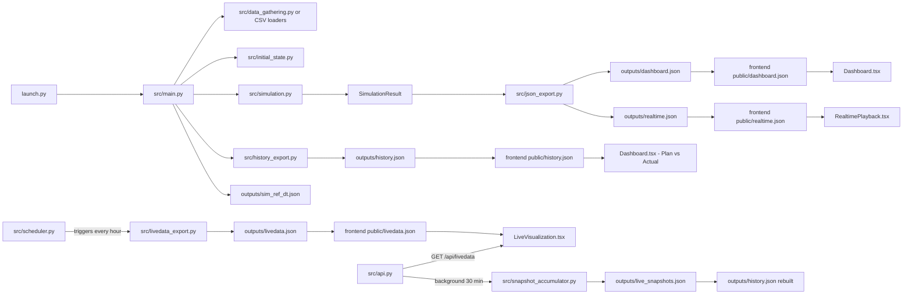

# Developer Documentation

This folder contains the technical documentation for developers working on the simulation backend, JSON contract, and React frontend.

Last updated: 2026-05-04

## Scope

This documentation explains:
- How runtime execution is orchestrated.
- How production data is loaded (DB or CSV).
- How the SimPy model dispatches LASER and EDM work.
- How JSON payloads are generated.
- How the frontend consumes those payloads.
- How to extend behavior while keeping backend/frontend compatibility.

## End-to-End Architecture



## Repository Module Map

| Area | Main files | Responsibility |
|---|---|---|
| Runtime orchestration | `launch.py`, `src/main.py` | Interactive menu + CLI, data loading, simulation execution, export flow |
| Data access | `src/data_gathering.py`, CSV loaders in `src/simulation.py` | Read and normalize DB/CSV input; real-time machine/stock queries |
| Simulation core | `src/simulation.py` | SimPy entities, dispatch policy, stock routing, event logging |
| Startup state | `src/initial_state.py` | Generate or load initial trays/machine progress |
| Production seed | `snapshot_now.py` | Full production snapshot: real state → initial_state for simulation |
| JSON export | `src/json_export.py` | Convert `SimulationResult` to dashboard/realtime payloads |
| History export | `src/history_export.py` | Real production timeline (EDM Entrada/Saída pairs) → `history.json` (Plan vs Actual) |
| Snapshot accumulator | `src/snapshot_accumulator.py` | Accumulate periodic live snapshots → rebuild `history.json` continuously |
| Live data export | `src/livedata_export.py` | Generate `livedata.json` from live DB data (hourly snapshot, file-based mode) |
| Live View API | `src/api.py` | FastAPI server — live data, simulation job control, and history endpoints |
| Live data scheduler | `src/scheduler.py` | Trigger `livedata_export.py` on a fixed interval during the shift (file-based mode only) |
| JSON validation | `src/validate_schema.py` | Validate generated JSON files against the contract schema |
| Frontend contract/types | `Dashboard and Real-Time Playback/src/app/data.ts` | Typed mirror of JSON payloads |
| Frontend views | `Dashboard and Real-Time Playback/src/app/components/*.tsx` | Dashboard, Realtime Playback, and Live View rendering |

## Run Modes

All commands should be run from the repository root in PowerShell.

### 1. Interactive menu (recommended — selects mode automatically)

```powershell
python launch.py
```

A numbered menu appears with the available profiles. The default (profile 1) starts the API
server and the frontend without running the simulation. Press Enter to accept the default or
type a number to select a profile.

Profiles available:
1. **Production (DB + API + Frontend)** — starts `api.py` on port 8001, then the Vite frontend.
2. **Production (DB + file-based Live View + Frontend)** — generates `livedata.json` once then starts the frontend.
3. **Simulation only — DB (no frontend)** — runs the simulation and exports JSON files only.
4. **Test data — CSV (no DB required)** — uses local CSV files, starts the frontend.
5. **Test data — CSV, no frontend** — CSV simulation, no frontend.

### 2. Backend only — generate JSON and report (no frontend)

```powershell
python launch.py --data-source db --no-frontend
```

### 3. CSV mode (local test data, no DB required)

```powershell
python launch.py --data-source csv --no-frontend
```

### 4. Refresh live data manually (single update)

```powershell
python src/livedata_export.py
```

### 5. Frontend only (after JSON files are already present in `public/`)

```powershell
cd "Dashboard and Real-Time Playback"
npm install
npm run dev
```

### 6. Validate generated JSON against contract

```powershell
python src/validate_schema.py --all
```

DB mode reads credentials from CLI args or environment variables:
- `SIM_DB_SERVER`
- `SIM_DB_NAME`
- `SIM_DB_USER`
- `SIM_DB_PASSWORD`
- optional `SIM_DB_DRIVER`

`.env` files are read from:
- repository root: `.env`
- source folder: `src/.env`

## Main Output Artifacts

Generated by backend (simulation):
- `outputs/dashboard.json`
- `outputs/realtime.json`
- `outputs/simulation_report.txt`
- `outputs/history.json` — real production timeline (Plan vs Actual), generated by `history_export.py`
- `outputs/sim_ref_dt.json` — simulation reference datetime; consumed by the API background refresh thread

Generated by live data pipeline:
- `outputs/livedata.json`
- `outputs/live_snapshots.json` — accumulated periodic machine-state snapshots for history rebuild

Mirrored for frontend (via `--export-figma-json` or `livedata_export.py`):
- `Dashboard and Real-Time Playback/public/dashboard.json`
- `Dashboard and Real-Time Playback/public/realtime.json`
- `Dashboard and Real-Time Playback/public/livedata.json`
- `Dashboard and Real-Time Playback/public/history.json`

## Documentation Index

- `backend-architecture.md`
  - Full simulation internals, dispatch rules, state model, live view pipeline, and KPI generation.
- `json-contract.md`
  - Precise backend/frontend schema and semantic rules for every field.
- `frontend-guide.md`
  - React architecture, timeline/playback/live view rendering internals, and extension patterns.
- `metric-extension-guide.md`
  - Step-by-step implementation workflow for adding a new metric end-to-end.
- `improvement-backlog.md`
  - Separate backlog for future enhancements (kept outside runtime behavior docs).

## Suggested Reading Order

1. `backend-architecture.md`
2. `json-contract.md`
3. `frontend-guide.md`
4. `metric-extension-guide.md`
