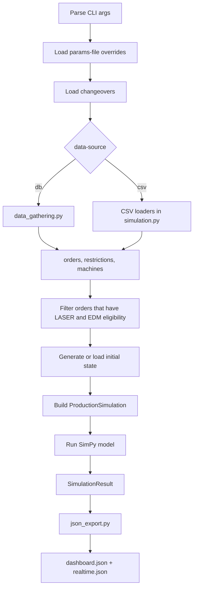
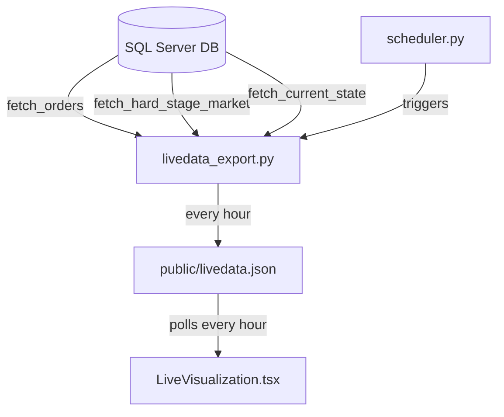
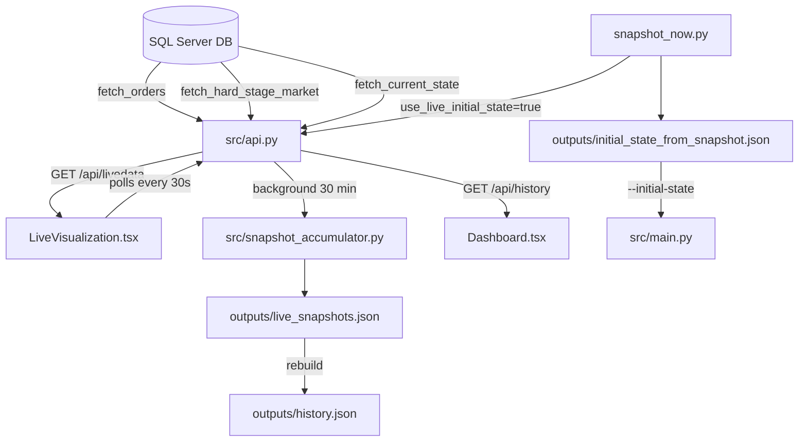

# Backend Architecture

Last updated: 2026-05-04

## 1. Entry Points And Runtime Ownership

### `launch.py`
`launch.py` is the top-level orchestrator used by most developers.

When launched without explicit mode flags it shows an **interactive numbered menu** (timeout 15 s → profile 1 default).

Available profiles:
1. **Production (DB + API + Frontend)** `[recommended]` — starts `api.py` then the Vite dev server. Does **not** auto-run the simulation.
2. **Production (DB + file-based Live View + Frontend)** — generates `livedata.json` once, then starts the frontend.
3. **Simulation only — DB (no frontend)** — runs simulation immediately, exports JSON, exits.
4. **Test data — CSV (no DB required)** — uses CSV files, starts the frontend.
5. **Test data — CSV, no frontend** — CSV simulation, no frontend.

Responsibilities:
- Presents the interactive profile menu (unless explicit CLI flags are given).
- Executes backend simulation by spawning `src/main.py` (profiles where `auto_run_simulation=True` or `--run-simulation-now` is set).
- Optionally starts the FastAPI Live View API server (`src/api.py`).
- Writes `.env.local` in the frontend folder via `_configure_frontend_env()` to point the Vite app at the correct API URL and poll interval.
- Optionally starts the frontend dev server in `Dashboard and Real-Time Playback/`.
- Optionally opens `http://localhost:5173`.
- Kills any stale process occupying the API port before starting (`_kill_listeners_on_port`).

Main CLI flags:
- `--no-frontend`
- `--no-open-browser`
- `--no-interactive` — skip menu, use CLI flags only
- `--run-simulation-now` — run simulation immediately before starting API/frontend
- `--python`
- `--npm`
- `--realtime-step-sec`
- `--livedata` — refresh `livedata.json` from DB once (file-based mode); ignored when `--api` is set
- `--livedata-input-filter` — forwarded to `livedata_export.py` as `--input-filter`
- `--api` — start the FastAPI server instead of the file-based livedata pipeline
- `--api-host` — bind host for the API server (default: `127.0.0.1`)
- `--api-port` — bind port for the API server (default: `8000`; production profile uses `8001`)

### `src/main.py`
`src/main.py` is the backend CLI entry point and pipeline coordinator.

Responsibilities:
- Parse runtime configuration.
- Load source data from DB or CSV.
- Normalize and filter orders/restrictions.
- Build initial state.
- Configure and run `ProductionSimulation`.
- Export JSON payloads and text report.

## 2. Runtime Pipeline



## 3. Configuration Model (`src/main.py`)

The CLI can be grouped into functional blocks.

### 3.1 Input source and files
- `--data-source {csv,db}`
- `--data-dir`
- `--orders`
- `--machines`
- `--machine-restrictions`
- `--changeovers`
- `--input-filter`

### 3.2 DB connection
- `--db-server`
- `--db-name`
- `--db-user`
- `--db-password`
- `--db-driver`

If DB args are omitted, `src/data_gathering.py` resolves values from `SIM_DB_*` environment variables.

### 3.3 Simulation policy
- `--tray-size`
- `--order-parallel-qty`
- `--campaign-mode` / `--no-campaign-mode`
- LASER throttling parameters:
  - `--laser-diverse-queue-threshold`
  - `--laser-parallel-cap-diverse-queue`
  - `--laser-mid-stock-fill-ratio`
  - `--laser-high-stock-fill-ratio`
  - `--laser-parallel-cap-mid-stock`
  - `--laser-parallel-cap-high-stock`
- LASER full-shift OFF parameters:
  - `--laser-shift-off-policy` / `--no-laser-shift-off-policy`
  - `--laser-shift-off-stock-fill-ratio`
  - `--laser-shift-off-max-queue-trays`
  - `--laser-shift-off-min-completion-ratio`
  - `--laser-shift-off-max-remaining-ratio`
  - `--laser-shift-off-guard-window-sec`

### 3.4 Capacity and runtime limits
- `--stock-capacity-trays`
- `--stock-capacity-parts`
- `--edm-changeover-operators`
- `--max-orders`
- `--max-machines`
- `--max-sim-hours`
- `--poll-interval-sec`
- `--summary-interval-sec`

### 3.5 Export controls
- `--export-json` / `--no-export-json`
- `--export-figma-json` / `--no-export-figma-json`
- `--realtime-step-sec`
- `--compress-realtime` — write `realtime.json.gz` (gzip) instead of plain JSON (~80 % smaller for large simulations)
- `--progress` — enable periodic progress lines during simulation run

## 4. Data Loading And Normalization

## 4.1 DB path (`src/data_gathering.py`)

`get_engine(...)` builds an SQLAlchemy engine for SQL Server using `pyodbc`.

`fetch_all_filtered(...)` loads and returns a 4-tuple:
- `df_orders` via `fetch_orders` — from `silver_orders.orders_10digit`
- `df_restrictions` via `fetch_restrictions` — machine/part eligibility and process times
- `df_machines` via `fetch_machines` — machine list with `line_id` and `process_type`
- `df_hard_stage` via `fetch_hard_stage_market` — Hard Stage inventory from `silver_production.inventory`

If `--input-filter` exists, it is parsed for `order_id` and `part_number_id`, then applied as SQL `IN` filters.

`fetch_hard_stage_market(engine)` returns one row per nozzle PN with its body PN and stock quantity:
- `part_number_id` — nozzle TYPE_NUMBER
- `body_number_id` — body BODY_TYPE_NUMBER
- `qtty_hardstage` — current Hard Stage stock (pieces)
- `max_date_hardstage` — last update timestamp

`get_eligible_part_numbers(df_restrictions)` — returns the set of PNs that have at least one entry in the restrictions table. Used to filter `fetch_production_seed_rows`.

`fetch_production_seed_rows(engine, eligible_part_numbers)` — returns the current machine activity and buffer stock rows from the DB to seed the simulation's initial state. Only rows whose PN is in `eligible_part_numbers` are returned.

`fetch_data_last_updated(engine)` — returns the ISO timestamp of the most recent `DT_UPDATE` in `b2b_machine_status`. Included in the `metadata` of every `/api/livedata` response.

### Live View DB functions (implemented)

The following functions power the real-time snapshot. All location-determining queries apply
`DATE >= '2026-04-01'` to exclude records before formal tracking began.

| Function | Table(s) | Returns |
|---|---|---|
| `fetch_machine_status(engine)` | `b2b_machine_status`, `nozzle_restrictions` | Current state of all 50 AGIE machines (Entrada without matching Saída = RUNNING) |
| `fetch_buffer_stock(engine)` | `b2b_machine_status` | Trays whose last event = Gravadora Saída (in buffer, not yet at AGIE) |
| `fetch_finished_goods(engine)` | `b2b_machine_status`, `b2b_supermarket_status` | Trays whose last event = AGIE Saída (in output supermarket) |
| `fetch_laser_status(engine)` | `b2b_machine_status` | Trays whose last event = Gravadora Entrada (currently at laser) |
| `fetch_produced_today(engine)` | `b2b_machine_status` | All pieces that left AGIE since 2026-04-01, grouped by TypeNumber |
| `fetch_machine_oee(engine, oee_hours)` | `b2b_machine_status`, `simulation_agie_process_time` | OEE per machine from completed runs within `oee_hours` window |
| `fetch_destination_routing(engine)` | *(stub — returns empty DataFrame)* | TypeNumber → `'HE'` or `'PACKAGING'` destination |
| `fetch_data_last_updated(engine)` | `b2b_machine_status` | ISO timestamp of most recent event in the DB |

`fetch_current_state(engine, oee_hours, off_hours, market_timeout_hours, default_test_min)` — **IMPLEMENTED**.
Orchestrates all live functions above and returns the full snapshot dict consumed by `api.py`.

`_build_final_markets(df_fg, df_orders, routing_map, market_timeout_hours, now)` — internal helper.
Splits finished goods into HE and Packaging markets, applying order-completion and timeout logic.

## 4.2 CSV path (loaders in `src/simulation.py`)

CSV readers support both comma and semicolon separators and tolerate multiple source column aliases.

Key loaders:
- `load_orders`
- `load_machines`
- `load_restrictions`
- `load_changeovers`

## 4.3 Eligibility filter applied in `main.py`

After loading restrictions, only part numbers eligible for both processes are kept.

Rule:
- keep order if part has LASER and EDM entries in `restrictions.allowed`

This guarantees trays can complete the full flow LASER -> EDM.

## 4.4 Hard Stage Market constraint (DB mode)

When running with `--data-source db`, `main.py` builds `hsm_stock_by_pn` — a dictionary mapping each nozzle `part_number_id` to its available stock quantity (pieces) from `df_hard_stage`.

This is passed to `ProductionSimulation(hsm_stock=hsm_stock_by_pn)` and enforces:

1. **Order filtering**: Only orders whose PN exists in the HSM (with stock > 0) are enqueued.
2. **Quantity capping**: Each order's producible quantity is limited to the remaining HSM budget for that PN. E.g. if an order requests 2400 pieces but HSM only has 300, only 300 are produced.
3. **HSM continuation**: After all SAP orders are fulfilled, any remaining HSM stock is produced as continuation trays (`order_id = "HSM_{pn}"`). These use the same dispatch and optimization logic as real orders.
4. **Budget consumption**: HSM budget is consumed per-order in priority order. Multiple orders for the same PN share the budget.

In CSV mode, `hsm_stock` is `None` and no HSM constraint is applied (backward compatible).

Diagnostic output during initialization:
```
- Hard Stage Market: 42 nozzle PNs, 185000 total pieces
- HSM PNs eligible (LASER+EDM): 38
- Order PNs covered by HSM: 25 / 30
```

## 5. Domain Model (`src/simulation.py`)

Core dataclasses:
- `Order(order_id, part_number_id, product_type, quantity)`
- `MachineSpec(machine_id, process_type, machine_type, line_id)`
- `Tray(tray_id, order_id, part_number_id, product_type, pieces)`
- `EventLog(...)`
- `StockEvent(...)`
- `StepSummary(...)`
- `SimulationResult(...)`

Operational classes:
- `Machine`: SimPy process for one physical machine.
- `Restrictions`: eligibility and cycle time lookup.
- `ChangeoverLookup`: symmetric type-to-type changeover durations.
- `Stock`: EDM line buffer with tray and part capacity.
- `EdmLine`: line identifier + stock + machine list.
- `ProductionSimulation`: model controller and dispatch policies.

## 6. Build Phase

`ProductionSimulation.build()`:
- Creates all `Machine` objects.
- Splits machines into:
  - `self.lm_machines` (LASER)
  - `self.edm_lines[line_id].machines` (EDM)
- Creates one dispatcher process for:
  - LASER input queue
  - each EDM line stock queue
- Creates periodic snapshot process (`_snapshotter`).

## 7. Time Model And Shift Semantics

Shift windows are represented in simulation-relative seconds:
- `0h-9h`
- `9h-18h`
- `18h-24h`

Frontend maps these offsets to clock time with start hour `06:00`, therefore:
- `0h-9h` -> `06:00-15:00`
- `9h-18h` -> `15:00-00:00`
- `18h-24h` -> `00:00-06:00`

Helper methods:
- `_shift_key(time_sec)` -> `(day_idx, shift_idx)`
- `_shift_bounds(time_sec)` -> `(shift_start_sec, shift_end_sec)`
- `_seconds_until_next_shift(time_sec)`

## 8. Dispatch Engine

The dispatcher loop lives in `_dispatcher(...)` and runs per queue (LASER input, EDM line stock).

## 8.1 Base parallelism per order

`order_max_parallel[order_id] = ceil(order.quantity / order_parallel_qty)`

This creates a per-order baseline maximum number of concurrent machines.

## 8.2 Effective LASER parallelism

`_effective_max_parallel(order_id, "LASER", time_sec)` applies extra policy gates:

1. If near a likely LASER full-shift OFF:
- return baseline parallelism (relax stock throttling to drain work in-shift).

2. If queue diversity threshold is reached:
- cap to `laser_parallel_cap_diverse_queue`.

3. Stock-aware caps:
- if global EDM stock fill >= high threshold -> cap high
- else if fill >= mid threshold -> cap mid

## 8.3 EDM campaign selection

Per line and per shift, a campaign product type can be selected.

Key state:
- `edm_line_shift_campaign[(line_id, day_idx, shift_idx)] = product_type`

Initial campaign choice (`_choose_line_campaign`) scores each candidate product by:
- `len(trays_of_product) * 10`
- `eligible_machine_count * 5`

Dispatcher then prioritizes trays matching line campaign.

## 8.4 Candidate scoring formula

For each candidate tray and eligible machine:

Positive terms:
- `+120` if machine last product equals candidate product
- `+35` if machine is pinned for this order/process
- `+12` if machine is preferred for this part/process
- `+80` if EDM candidate matches active line campaign
- `+(1 - stock_fill_ratio) * 8` for LASER

Negative terms:
- `-45` if EDM candidate conflicts with active line campaign (when campaign-aligned work exists)
- `-parallel_pressure * 18` to avoid monopolization
- `-idx * 0.02` to keep FIFO tendency in tie-breaks

`parallel_pressure = active_machines_for_order / max_parallel`

Best score wins and starts immediately.

## 8.5 LASER full-shift OFF policy

Decision function `_compute_laser_shift_off_decision()` turns a LASER shift OFF when all are true:
- `global_edm_stock_fill_ratio >= laser_shift_off_stock_fill_ratio`
- `laser_queue_trays <= laser_shift_off_max_queue_trays`
- `completion_ratio >= laser_shift_off_min_completion_ratio`
- `remaining_ratio <= laser_shift_off_max_remaining_ratio`
- `edm_stock_trays > 0`

Where:
- `completion_ratio = completed_trays / total_trays`
- `remaining_ratio = laser_queue_trays / total_trays_all`

Behavior details:
- Decision is cached per `(day_idx, shift_idx)` in `laser_shift_off_decision`.
- When OFF, LASER dispatcher sleeps until next shift boundary.
- Guard window (`laser_shift_off_guard_window_sec`) prevents starting LASER jobs that would cross into the next OFF shift.

## 9. Machine Execution Lifecycle (`Machine._run`)

For each tray on a machine:

1. Resolve changeover and test durations from `ChangeoverLookup`.
2. Resolve processing duration from `Restrictions.get_cycle_time(machine_id, part_number_id) * tray.pieces`.
3. Emit events in order:
   - optional `waiting` (EDM changeover operator queue)
   - optional `changeover`
   - optional `test` (EDM only)
   - `process`
4. Update machine runtime counters and release machine.

Busy time includes:
- `changeover`
- `test`
- `process`

## 10. LASER -> EDM Routing

When LASER finishes a tray (`_on_lm_complete`), tray is routed to EDM stock by `_route_to_edm_stock`.

Eligible EDM lines are scored by:
- `compatible_machine_count * 5`
- `+min(6, same_product_in_stock)`
- `-fill_ratio * 10`
- `+20` if line campaign matches tray product
- `-6` if line campaign exists and differs

Highest feasible line receives stock `put` event.

When EDM dispatch consumes a tray from stock:
- stock tray removed from line buffer
- stock `get` event logged

## 11. Completion And Stop Conditions

- EDM completion increments `completed_trays` and `completed_parts`.
- If `target_order_ids` is active (max-orders mode), completion tracks only target subset.
- Simulation stops when target trays complete or `max_time_sec` timeout is reached.
- HSM continuation trays and initial-state fallback trays are included in total tray counts.

If timeout ends while machines are still in activity, `_finalize_open_events()` closes open events at `env.now`.

## 11.1 Initial State Fallback Trays

When applying the initial state (`_apply_initial_state`), machines or buffer positions may reference PNs that were filtered out by the HSM constraint (e.g. a machine processing a non-HSM PN).

To preserve the real production state:
- **In-progress machines**: An ad-hoc fallback tray is created so the machine can finish its current piece. No new work is started for that PN.
- **Buffer stock**: Ad-hoc trays are created for buffer entries whose PN is not in the LASER input queue.

Fallback trays use `order_id = "INITIAL_{machine_id}"` or `"INITIAL_BUF_{line_id}"` and are counted in `total_trays_all`.

## 12. Inactive Event Injection And Utilization

After run ends, full-shift inactivity is computed per machine:
- For each shift window and machine, check overlap with any work activity:
  - `process`, `changeover`, `test`, `waiting`
- If none overlaps, add one `inactive` event for that full window.

Utilization computation:
- `available_time = total_time_sec - inactive_time`
- `machine_utilization[machine] = busy_time / available_time`
- `average_utilization = sum(busy_time) / sum(available_time)`

## 13. Snapshot Model

`_snapshotter()` records `StepSummary` periodically (`summary_interval_sec`) and at startup.

Each snapshot includes:
- queue depth (`lm_queue_trays`)
- stock per EDM line (`edm_stock_trays`)
- number of busy LASER/EDM machines
- completed trays and parts
- machine status `(part_number_id, tray_id)`

These snapshots feed progress logging and final report sections.

## 14. Initial State Integration

`main.py` supports three startup modes:

1. `--generate-initial-state`
- writes a JSON file and uses it for the run.

2. `--initial-state <path>`
- reads explicit startup state.

3. default
- generates an in-memory initial state automatically.

Initial state can preload:
- machine activity progress (`percent_complete`)
- trays already in EDM stock
- completed trays/parts counters

## 15. Export And Reporting

After simulation:
- `json_export.export_dashboard_json(...)`
- `json_export.export_realtime_json(...)` — supports optional gzip compression (`compress=True`)
- `history_export.export_history_json(engine, ref_dt)` — real production timeline (DB mode only)

Artifacts:
- `outputs/dashboard.json`
- `outputs/realtime.json` (or `outputs/realtime.json.gz` if `--compress-realtime`)
- `outputs/history.json` — actual production events for Plan vs Actual view
- `outputs/sim_ref_dt.json` — simulation reference datetime (UTC ISO); used by API background refresh
- optional copies to frontend `public/`
- `outputs/simulation_report.txt`

`sim_ref_dt.json` is written unconditionally in DB mode and is read by `src/api.py` every 30 minutes to rebuild `history.json` from live machine-state snapshots.

## 16. Live View Pipeline

The Live View frontend component (`LiveVisualization.tsx`) fetches live production floor data
from one of two modes: **file-based** (original) or **API** (recommended for server deployments).

---

### Mode A — File-based (original, no server required)

#### `src/livedata_export.py`

Standalone script that generates `livedata.json` from live DB data.

Responsibilities:
- Connects to DB using the same `get_engine()` / env vars as the simulation.
- Calls `fetch_orders()` to build `orders_by_id` (order_id, part_number_id, quantity, due_date).
- Calls `fetch_hard_stage_market()` to build `hard_stage_market` (body_partnumber, body_qtty, nozzles[]).
- Calls `fetch_current_state()` for the real-time machine/stock snapshot.
- Writes to `outputs/livedata.json` and `Dashboard and Real-Time Playback/public/livedata.json`.

CLI usage:
```powershell
python src/livedata_export.py                                  # default: outputs/ + public/
python src/livedata_export.py --input-filter data/input_data.csv
python src/livedata_export.py --output path/to/livedata.json
python src/livedata_export.py --dry-run                        # print JSON to stdout
```

#### `src/scheduler.py`

Scheduler that calls `livedata_export.py` on a fixed interval during the shift.

Responsibilities:
- Runs `livedata_export.py` immediately at startup.
- Repeats every `--interval-sec` (default: 3600 s = 1 hour).
- Stops automatically when the shift ends (shift start 06:00, duration 24 h).
- Exits gracefully on Ctrl+C.
- Supports `--run-once` mode for use with external schedulers (cron, Windows Task Scheduler).

CLI usage:
```powershell
python src/scheduler.py                             # hourly loop for full shift
python src/scheduler.py --interval-sec 1800         # every 30 minutes
python src/scheduler.py --run-once                  # single export, then exit
python src/scheduler.py --input-filter data/input_data.csv  # forwarded to livedata_export
```

File-based data flow:


---

### Mode B — API (recommended for server deployments)

#### `src/api.py`

FastAPI server (`version="1.1.0"`) that exposes live data, simulation control, and history as HTTP endpoints.
Replaces `livedata_export.py` + `scheduler.py` for deployments where a dedicated server is available.

Responsibilities:
- Creates a single DB engine at startup (reused across all requests).
- Caches DB results in memory for `CACHE_TTL_SECONDS` (default: 300 s / 5 min).
- Calls `fetch_orders()` and `fetch_hard_stage_market()` from `data_gathering.py`.
- Calls `fetch_current_state()` for the real-time machine/stock snapshot (no fallback — returns HTTP 503 if DB is unavailable).
- Starts a background thread on startup that takes a live snapshot every 30 minutes (`HISTORY_REFRESH_INTERVAL_SEC = 1800`) and rebuilds `history.json` via `snapshot_accumulator.py`.

Endpoints:

| Method | Path | Description |
|---|---|---|
| `GET` | `/api/health` | Server health + DB connectivity check |
| `GET` | `/api/orders` | `orders_by_id` payload (cached 5 min) |
| `GET` | `/api/hard-stage` | `hard_stage_market` payload (cached 5 min) |
| `GET` | `/api/snapshot` | Current machine/stock frame from DB (not cached) |
| `GET` | `/api/livedata` | Full payload consumed by `LiveVisualization.tsx` |
| `GET` | `/api/history` | Real production timeline for Plan vs Actual view |
| `GET` | `/api/simulation/status` | Active simulation job status + whether outputs exist |
| `GET` | `/api/simulation/jobs/{job_id}` | Details of a specific simulation job |
| `POST` | `/api/simulation/run` | Trigger a new async simulation run (returns `job_id`) |

Query parameters for `/api/livedata` and `/api/snapshot`:

| Parameter | Default | Description |
|---|---|---|
| `oee_hours` | 168 | Window in hours for OEE calculation |
| `off_hours` | 168 | Hours without completed run → machine appears as OFF |
| `market_timeout_hours` | 24 | Hours after which a TypeNumber with no open orders disappears from the final market |
| `default_test_min` | 60 | Default release (test) time in minutes for changeover pairs not in the CSV |

`POST /api/simulation/run` accepts a JSON body (`SimulationRunRequest`):

| Field | Default | Description |
|---|---|---|
| `data_source` | `"db"` | `"db"` or `"csv"` |
| `max_sim_hours` | `24.0` | Simulation horizon in hours (0.1–72) |
| `input_filter` | `null` | Path to filter CSV (forwarded to `main.py`) |
| `use_live_initial_state` | `true` | If `true`, runs `snapshot_now.py` first to seed the initial machine state |

Interactive docs available at `http://server:8001/docs` (Swagger UI) when the server is running.

CLI usage:
```powershell
# Development (auto-reload):
uvicorn src.api:app --reload --port 8001

# Production (expose on network):
uvicorn src.api:app --host 0.0.0.0 --port 8001 --workers 2

# Via launch.py (recommended — also starts frontend):
python launch.py --api --api-host 0.0.0.0 --api-port 8001
```

Frontend configuration (`launch.py` writes this automatically):
```
VITE_LIVEDATA_JSON_URL=http://127.0.0.1:8001/api/livedata
VITE_SIMULATION_API_BASE_URL=http://127.0.0.1:8001
VITE_LIVE_POLL_INTERVAL_MS=30000
```

No changes to `LiveVisualization.tsx` or `data.ts` are required.

API data flow:


#### `snapshot_now.py`

Top-level script that captures a full production snapshot and generates a ready-to-use `initial_state` for the simulation.

Output: `snapshot_now_output.json` containing:
- `metadata` — generation timestamp
- `machines` — 50 AGIE machines with current activity and `percent_complete`
- `laser_summary`, `stock_levels`, `finished_goods`, `he_market`, `packaging_market`
- `backlog_orders`, `produced_orders`, `orders_by_id`, `hard_stage_market`
- `restrictions` — full PN × machine × cycle time table
- `cycle_time_map` — quick lookup `"machine_type|part_number_id"` → seconds/piece
- `initial_state` — object ready to pass to `ProductionSimulation` via `--initial-state`

Used automatically by `api.py` when a simulation is triggered with `use_live_initial_state=true`.

#### `src/snapshot_accumulator.py`

Accumulates periodic live machine-state snapshots and derives a continuous real production timeline.

File managed: `outputs/live_snapshots.json`

Key functions:
- `reset(path, sim_ref_dt)` — clear all snapshots and record a new simulation reference datetime.
- `append(path, machines_raw, sim_ref_dt)` — add a new snapshot to the accumulation file.
- `export_history_from_snapshots(snapshots_path, history_output, now_offset_sec, sim_ref_dt, mirror_path)` — derive timeline events from state changes between consecutive snapshots and write `history.json`.

State change detection: compares `(activity, tray_id, entry_datetime)` between consecutive snapshots per machine. When a change is detected, the previous event is closed and a new one opens.

#### `src/history_export.py`

Generates `history.json` from real EDM production events in the DB.

`fetch_edm_timeline(engine, ref_dt, horizon_hours)` — queries `b2b_machine_status` for all completed Entrada/Saída pairs at stage `03 - Agie` within the `horizon_hours` window. In-progress trays (Entrada without Saída) generate an open-ended event ending at *now*.

`export_history_json(engine, ref_dt, output)` — builds the full `history.json` payload and writes it. Called by `main.py` at the end of every simulation run (DB mode only).

---

## 17. Backend Extension Workflow

When extending behavior:

1. Update simulation logic in `src/simulation.py`.
2. Ensure event model still exposes required fields.
3. Update JSON exporters if payload semantics change.
4. Update frontend TS types in `src/app/data.ts`.
5. If the change affects live data: update `src/livedata_export.py` (file mode) **and** `src/api.py` (API mode).
6. Regenerate JSON and validate both views.

This keeps simulation policy, contract, and UI aligned.
