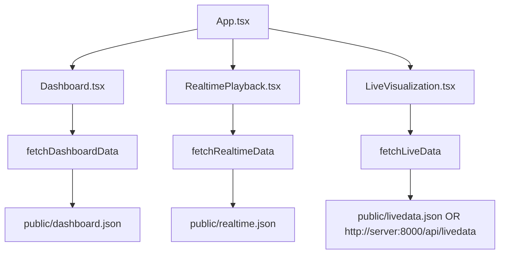

# Frontend Developer Guide

Last updated: 2026-05-04

## 1. Purpose

This document explains how the React frontend works at implementation level.

It covers:
- component ownership and responsibilities
- data loading and runtime state
- timeline rendering model
- realtime playback model
- live view model
- interaction flows and extension points

This guide is intentionally focused on current behavior and architecture.

## 2. Project Boundaries

Frontend root:
- `Dashboard and Real-Time Playback/`

Entry and shell:
- `src/main.tsx`
- `src/app/App.tsx`

Main views:
- `src/app/components/Dashboard.tsx`
- `src/app/components/RealtimePlayback.tsx`
- `src/app/components/LiveVisualization.tsx`

Shared frontend contract/types:
- `src/app/data.ts`

Shared UI primitives:
- `src/app/components/ui/*`

## 3. Runtime Flow



`App.tsx` handles shell and tab selection: `dashboard`, `realtime`, or `live`.
Data acquisition and rendering logic are fully contained in each screen component.

## 4. Data Layer (`src/app/data.ts`)

`data.ts` centralizes:
- color constants (`BOSCH_COLORS`)
- KPI thresholds (`KPI_THRESHOLDS`)
- traffic color helper (`getTrafficColor`)
- TypeScript interfaces for dashboard/realtime/livedata payloads
- `fetchDashboardData()`, `fetchRealtimeData()`, `fetchLiveData()`, and `fetchHistoryData()`

Fetch URL resolution (all use `cache: 'no-store'`):

| Constant | Env override | Default |
|---|---|---|
| `DASHBOARD_URL` | `VITE_DASHBOARD_JSON_URL` | `{BASE_URL}dashboard.json` |
| `REALTIME_URL` | `VITE_REALTIME_JSON_URL` | `{BASE_URL}realtime.json` |
| `LIVEDATA_URL` | `VITE_LIVEDATA_JSON_URL` | `{BASE_URL}livedata.json` |
| `HISTORY_URL` | `VITE_HISTORY_JSON_URL` | `{BASE_URL}history.json` |
| `SIMULATION_API_BASE` | `VITE_SIMULATION_API_BASE_URL` | `''` (derived from `LIVEDATA_URL` if set) |

**API mode:** to point the Live View at the FastAPI server instead of a static file,
set `VITE_LIVEDATA_JSON_URL=http://server:8001/api/livedata` in `.env.local` before building.
No component changes are required — `fetchLiveData()` is URL-agnostic.

**Poll interval:** `VITE_LIVE_POLL_INTERVAL_MS` controls the auto-refresh interval for Live View
(default when set by `launch.py`: `30000` ms = 30 s). Without this variable the frontend uses its own
internal default.

### Key TypeScript interfaces

```
DashboardData       – metadata?, kpis, machines, timeline, stock_final, orders
RealtimeData        – metadata, orders_by_id?, hard_stage_market?, frames[]
LiveData            – metadata (LiveMetadata), orders_by_id?, hard_stage_market?, snapshot (RealtimeFrame + extensions)
HistoryData         – metadata, timeline[]
HardStageMarketItem – body_partnumber, body_qtty, nozzles[]
FinalMarketItem     – part_number_id, total_pieces, oldest_entry_date, pending_orders[]
FinalMarketOrder    – order_id, quantity, due_date, remaining_needed
OrderMeta           – order_id, due_date?, part_number_id?, quantity?
LiveMetadata        – generated_at, data_last_updated?, current_time_label?, facility_timezone?
MachineState        – activity, order_id?, part_number_id?, start_sec?, end_sec?, current_oee, rfid_id?
RealtimeFrame       – time_sec, backlog_orders[], produced_orders[], stock_levels[], machines[]
LiveSettings        – oeeHours, offHours, marketTimeoutHours, manualOff[]
LaserSummaryItem    – part_number_id, waiting_trays, done_trays, waiting_pieces, done_pieces
```

## 5. Dashboard View (`Dashboard.tsx`)

## 5.1 State model

Primary state:
- `data`, `error`
- `selectedStock`
- `selectedOrderId`
- `selectedPartNumberId`
- `filteredPartNumberId`
- `showChangeoverModal`
- `showNowLine`

Derived selection:
- `activePartNumberId = filteredPartNumberId || selectedPartNumberId`

This allows synchronization between timeline selection and table filter selection.

## 5.2 Data load lifecycle

On mount:
1. `fetchDashboardData()` executes in `useEffect`.
2. payload is stored in `data`.
3. all chart/table/timeline sections re-render from payload.

The component does not mutate payload data; it derives display state with `useMemo`.

## 5.3 KPI and line-level analytics

Top KPI cards render values from `data.kpis`.

Additional line-level changeover analytics are derived client-side (`lineChangeoverStats`) from:
- `data.timeline`
- `data.machines`
- `data.kpis.total_time_sec`

Formula in UI for average loss per line:
- `(line_changeover_sec / (total_time_sec * line_machine_count)) * 100`

The changeover card is clickable and opens `ChangeoverDetailModal` with per-line breakdown.

## 5.4 Timeline subsystem (`TimelineChart`)

### 5.4.1 Time basis and clock mapping

Constants:
- `SHIFT_START_HOUR = 6`
- `SHIFT_BOUNDARY_HOURS = [6, 15, 0]`
- `SHIFT_CHANGE_HOURS = [15, 0]`
- `TIME_TICK_HOURS = 3`

Key helpers:
- `shiftHourToOffsetSec(hour)`: converts a clock hour to timeline offset in seconds.
- `formatClockTime(seconds, SHIFT_START_HOUR)`: converts offset back to `HH:MM`.

Timeline scale:
- `timeScaleSec` is fixed to one day (`24 * 3600`).

### 5.4.2 Event grouping and deterministic ordering

Events are grouped by `machine_id` and sorted by:
1. `start_sec`
2. `end_sec`
3. activity priority

Activity priority used by renderer:
- `inactive` -> `0`
- `waiting` -> `1`
- `changeover` -> `2`
- `test` -> `3`
- `process` -> `4`

This ordering ensures stable paint order for overlapping boundaries.

### 5.4.3 Geometry alignment (hours vs bars)

Timeline alignment uses measured DOM geometry:
- container ref: `timelineBodyRef`
- first lane query: `[data-timeline-lane="true"]`
- measured values: `laneOffsetPx`, `laneWidthPx`

Those measurements are reused for:
- tick labels
- shift labels
- shift boundary dashed lines
- now line

This guarantees all time references and machine bars use exactly the same horizontal coordinate system.

Recalculation triggers:
- window resize
- `ResizeObserver` updates
- machine grouping/collapse/filter changes

### 5.4.4 Sticky header behavior

The hour/shift label block is inside a sticky container:
- `sticky top-0`

Result:
- labels remain visible while vertical scrolling through machine rows.

### 5.4.5 Bar rendering math

For each event:
- `startSec = clamp(event.start_sec, 0, timeScaleSec)`
- `endSec = clamp(event.end_sec, 0, timeScaleSec)`
- render only if `endSec > startSec`
- `left = toPercent(startSec)`
- `width = toPercent(endSec) - toPercent(startSec)`

Color map:
- `process` -> `BOSCH_COLORS.chart.process`
- `changeover` -> `...changeover`
- `waiting` -> `...waiting`
- `inactive` -> `...inactive`
- `test` -> `...test`
- fallback -> `...idle`

### 5.4.6 Selection/filter interaction

Timeline filtering rules:
- if `filterPartNumberId` is active, non-matching non-inactive bars are hidden
- selected part bars keep full opacity and red outline
- non-selected part bars are dimmed (`opacity: 0.2`)

Clicking a process bar selects/deselects its `part_number_id`.

### 5.4.7 “Now line” behavior

`nowOffsetSec` is computed from current local clock and shifted by `06:00` start.

The now line color is driven by a runtime proxy:
- `oeeNow = running_process_machines / machines.length`
- color uses `getTrafficColor(oeeNow, KPI_THRESHOLDS.oee)`

## 5.5 Line and machine labels

Display adaptation:
- line `AgieX` -> `Corredor X`
- machine `EDM X` -> `Agie X`

This transformation is visual only; underlying IDs are unchanged.

## 5.6 Stock chart and stock details

Stock panel uses `Recharts` (`BarChart`, vertical layout).

Displayed dataset:
- `stock_final` (or filtered subset if a part is selected)

On bar click:
- selected stock row is opened in `StockDetailModal`

`StockTooltip` shows line, trays, and parts (when present).

## 5.7 Production table integration

`DataTable` receives full `orders` payload and supports:
- sorting
- filtering (including `part_number_id`)
- row click selection
- scroll target (`scrollToKey`) bound to current active selection

Row status column behavior:
- 100% -> green check icon
- 0% -> hourglass icon
- else -> progress bar with completion width

## 6. Realtime View (`RealtimePlayback.tsx`)

## 6.1 State model

Core state:
- `data`, `error`
- `isPlaying`
- `frameIndex`
- `playbackSpeed`
- `stepMode` (`minutes` or `percent`)
- `minuteStep`, `percentStep`
- `selectedZone`
- `selectedStock`

Derived values:
- `totalFrames`
- `safeIndex`
- `currentFrame`
- `stepFrames`

## 6.2 Frame stepping logic

`stepFrames`:
- minutes mode: `max(1, round((minuteStep * 60) / metadata.step_sec))`
- percent mode: `max(1, round((percentStep / 100) * totalFrames))`

Playback timer:
- `setInterval` advances by `stepFrames`
- clamped to last frame
- auto-disables play when last frame is reached

## 6.3 Process-flow layout mapping

Realtime screen is split into 5 zones:
1. Backlog
2. Laser Marking
3. Buffer Stock
4. EDM Lines
5. Finished Goods

Machine partitioning per frame:
- LASER: `process_type === 'LASER'`
- EDM: `process_type === 'EDM'`
- EDM grouped by `line_id` for line summary cards

## 6.4 Machine card (`MachineCard`) rules

Activity -> status mapping:
- `process` -> `RUNNING`
- `changeover` -> `SETUP`
- `waiting` -> `WAIT`
- `inactive` -> `OFF`
- `test` -> `TEST`
- default -> `IDLE`

Progress bar:
- hidden progression (`0`) for `idle` and `inactive`
- else interpolated by current frame time between `start_sec` and `end_sec`

Displayed identifiers:
- `part_number_id` preferred
- fallback to `order_id`

OEE badge in card uses `state.current_oee` from payload.

## 6.5 EDM line summary cards (`ZoneSummaryCard`)

Per-line derived counts:
- running
- setup
- waiting
- inactive
- idle

Derived KPIs:
- utilization proxy: `(total - idle) / total`
- average line OEE: average of `state.current_oee`

Click opens detail modal with all machines in the selected line.

## 6.6 Stock zone behavior

Stock cards render per `currentFrame.stock_levels`.
Each card shows:
- line name
- tray count with bar height scaling (`min(100, trays * 10)`)
- optional parts count
- first tray preview (`order_id`, `part_number_id`)

Click opens `StockDetailModal`.

## 6.7 Produced orders split

Produced orders are split by product type:
- `CRIN` -> HE panel
- `PLV` -> Assembly panel

Fallback branch:
- if produced orders exist but neither type appears, all orders are shown in HE panel.

## 7. Live View (`LiveVisualization.tsx`)

The Live View is the third main tab (`live`), showing the current production floor state.
Data is fetched from `fetchLiveData()`, which resolves to either `public/livedata.json` (file-based mode)
or `http://server:8001/api/livedata` (API mode), depending on `VITE_LIVEDATA_JSON_URL`.

> Full functional documentation: [`documentation/live-visualization.md`](live-visualization.md)

## 7.1 State model

Primary state:
- `data` (`LiveData | null`), `error`
- `isRefreshing`, `lastRefreshed`
- `isLive` — controls auto-poll toggle
- `selectedZone` — EDM line selected for `ZoneDetailModal`
- `selectedStock` — stock selected for `StockDetailModal`
- `selectedEdmLine` — corridor filter for EDM + Buffer Stock columns (`null` = all)
- `searchQuery` — global search string
- `settings` (`LiveSettings`) — persisted in `localStorage` via `SettingsModal`

## 7.2 Data load lifecycle

On mount:
1. `fetchLiveData({ oeeHours, offHours, marketTimeoutHours })` executes in `useEffect`.
2. payload is stored in `data`.
3. all zones re-render from `data.snapshot`.

Auto-poll:
- `POLL_INTERVAL_MS` — configurable via `VITE_LIVE_POLL_INTERVAL_MS` at build time (default set by `launch.py`: 30 s; frontend-internal default when variable is absent may differ).
- Active only when `isLive = true`.
- Manual refresh button always available.

Stale data behavior:
- If a refresh fails, warning banner is shown; previous payload remains visible.

## 7.3 Plant layout (7-zone grid)

Fixed 14-column CSS grid (`min-w-[1400px]`), horizontally scrollable on small viewports.

| Column span | Zone | Content |
|---|---|---|
| 1–2 | 1. Orders | Active orders (due_date ≥ today) + Backlog orders (grouped by due_date) |
| 3–4 | 2. Hard Stage Market | Body → nozzle stock, sorted by highest qty |
| 5–6 | 3. Laser Marking | TypeNumbers currently at the laser (Gravadora Entrada, not yet Saída) |
| 7–8 | 4. AGIE Entrance | Buffer stock per corridor (Gravadora Saída, not yet AGIE Entrada) |
| 9–12 | 5. EDM Lines | Corridor summary cards or machine grid (selectable via dropdown) |
| 13–14 | 6. Final Markets | **HE Market** (top half) + **Packaging Market** (bottom half) |

## 7.4 Orders zone

**Active orders** — `snapshot.backlog_orders` filtered to `due_date >= today` (client-side from `ordersById`).

**Backlog orders** — remaining IDs, grouped by `due_date`, sorted ascending.

For each order card, HSM body is looked up via `hardStageMarketItems.find(h => h.nozzles.includes(pn))`:
- `body_qtty < order.quantity` → red border + shortage indicator
- otherwise → blue (active) or yellow (backlog) border

All open orders come from `silver_orders.orders_10digit` — every row in the table is an open order.

## 7.5 Hard Stage Market zone

`data.hard_stage_market` sorted by **highest `body_qtty`** first (descending).
Each card: `body_partnumber`, `body_qtty`, inline scrollable nozzle list.
Rendered via `VirtualList` for performance.

## 7.6 Laser Marking zone

`snapshot.laser_summary` — TypeNumbers currently being processed at the laser.
Per card: `waiting_trays`, `waiting_pieces`.
Total pill at top showing aggregate trays and pieces.

## 7.7 Buffer Stock zone (AGIE Entrance)

Trays that left the laser (`Gravadora Saída`) but have not entered any AGIE yet.
Aggregated by corridor. Piece counts from `tray_details[].pieces`.
Clicking a card opens `StockDetailModal`.
Synchronized with `selectedEdmLine` dropdown.

## 7.8 EDM zone

Two modes via `<select>` dropdown:
- **All corridors** — `ZoneSummaryCard` per corridor with OEE badge, mini heatmap, and counts
- **Single corridor** — `MachineCard` grid (2–3 columns)

`ZoneSummaryCard` click → `ZoneDetailModal` (portal, full-screen).

OEE displayed: real value computed from completed `Entrada`/`Saída` pairs within `oeeHours` window.
Machines with no completed run within `offHours` → `activity = 'inactive'` (OFF).
Manual OFF overrides from `settings.manualOff` applied client-side.

## 7.9 Final Markets zone

One column (`col-span-2`) split vertically:

**HE Market** (top) — TypeNumbers routed to HE based on `fetch_destination_routing()`.
**Packaging Market** (bottom) — TypeNumbers routed to Packaging (default while routing stub is active).

Rendered by `FinalMarketColumn` sub-component. Per TypeNumber card:
- Total remaining pieces (after fulfilled orders subtracted)
- Progress bar toward oldest open order (red/yellow/green)
- Compact list of additional pending orders
- "Sem ordens abertas" label for TypeNumbers in timeout countdown

Order completion logic: oldest order is fulfilled first; when `total_pieces >= order.quantity`,
the order disappears and the excess remains visible.

Timeout logic: TypeNumbers with no open orders and `age >= marketTimeoutHours` are hidden entirely.

## 7.10 Global search bar

Input in the Live Status Bar header. Filters all sections client-side via `useMemo` (`q = searchQuery.trim().toLowerCase()`):

| Section | Filtered fields |
|---|---|
| EDM Lines | `machine_id`, `part_number_id`, `serial_number`, `line_id` |
| Laser | `part_number_id` |
| Hard Stage Market | `body_partnumber`, `nozzles[]` |
| Active + Backlog Orders | `order_id`, `part_number_id` |
| Buffer Stock | `part_number_id` per corridor (empty corridors hidden) |

Badge shows total match count. ✕ button clears query.

> ⚠️ HE Market and Packaging Market are **not yet filtered** by the search bar (pending implementation).

## 7.11 Settings (`SettingsModal`)

Accessible via gear icon in the status bar. Settings persisted in `localStorage` key `live_settings_v1`.

| Field | Default | Sent to API |
|---|---|---|
| `oeeHours` | 168 | `oee_hours` |
| `offHours` | 168 | `off_hours` |
| `marketTimeoutHours` | 24 | `market_timeout_hours` |
| `manualOff[]` | `[]` | Client-side only |

## 7.12 Sub-component inventory

| Component | Location | Purpose |
|---|---|---|
| `MachineCard` | local | Single machine state card |
| `ZoneSummaryCard` | local | Corridor summary (heatmap + stats) |
| `ZoneDetailModal` | local (portal) | Full-screen corridor machine grid |
| `LaserZone` | local | Laser summary list |
| `FinalMarketColumn` | local | HE / Packaging market column |
| `StockDetailModal` | `ui/StockDetailModal` | Full-screen tray list for a stock entry |
| `SettingsModal` | `ui/SettingsModal` | Configuration panel |
| `VirtualList` | `ui/VirtualList` | Virtualized list renderer |

## 8. Shared Modals And Cross-Component Contracts

Used modals:
- `StockDetailModal`
- `ChangeoverDetailModal`
- `ZoneDetailModal` (inside realtime component)

These components depend on stable keys from JSON contract (`line_id`, `tray_details`, `machines[].state`, etc.).

## 8. Contract Coupling Rules

Frontend expects backend contract as defined in `documentation/json-contract.md`.

When changing payload shape:
1. update exporter (`src/json_export.py` for dashboard/realtime, `src/livedata_export.py` for livedata)
2. regenerate JSON
3. update TS interfaces in `src/app/data.ts`
4. update component usage in Dashboard / Realtime / LiveVisualization

## 9. Extension Recipes

### 9.1 Add a dashboard KPI

1. add field to backend payload
2. add field to `KPI` interface
3. render new `KPICard`

### 9.2 Add a new activity state

1. emit activity in backend events
2. include activity in JSON
3. extend activity unions in `TimelineEvent` and `MachineState`
4. add mapping in timeline and machine card color/status logic
5. add legend item in dashboard

### 9.3 Add a new realtime zone panel

1. decide if data is static metadata or frame field
2. export in realtime payload
3. type in `RealtimeData` / `RealtimeFrame`
4. derive and render in `RealtimePlayback.tsx`

### 9.4 Add a new Live View panel

1. add field to live data payload:
   - **file-based mode**: via `src/livedata_export.py`
   - **API mode**: via `src/api.py` (in the `/api/livedata` endpoint builder)
2. type in `LiveData` or `RealtimeFrame` depending on scope
3. derive state in `LiveVisualization.tsx`
4. render as a new column in the 14-column plant grid

### 9.5 Replace snapshot with real-time machine state

1. implement `fetch_current_state()` in `src/data_gathering.py`
2. wire it up in **both** places:
   - `src/livedata_export.py` (replacing `_snapshot_from_realtime` fallback)
   - `src/api.py` (in `_get_snapshot()`, replacing the same fallback)
3. no frontend changes required — the `snapshot` field shape is already defined

## 10. Developer Commands

From repository root (PowerShell):

Run backend + frontend, file-based Live View (recommended for local dev):
```powershell
python launch.py --data-source db --export-figma-json --livedata
```

Run backend + frontend, API-based Live View (recommended for server deployment):
```powershell
python launch.py --data-source db --export-figma-json --api --api-host 0.0.0.0 --api-port 8000
```

Run backend only:
```powershell
python launch.py --data-source db --no-frontend
```

Start API server standalone (without running the simulation first):
```powershell
uvicorn src.api:app --reload --port 8000
```

Refresh live data manually (file-based mode):
```powershell
python src/livedata_export.py
```

Start hourly live refresh during shift (file-based mode):
```powershell
python src/scheduler.py
```

Frontend only:
```powershell
cd "Dashboard and Real-Time Playback"
npm install
npm run dev
```
