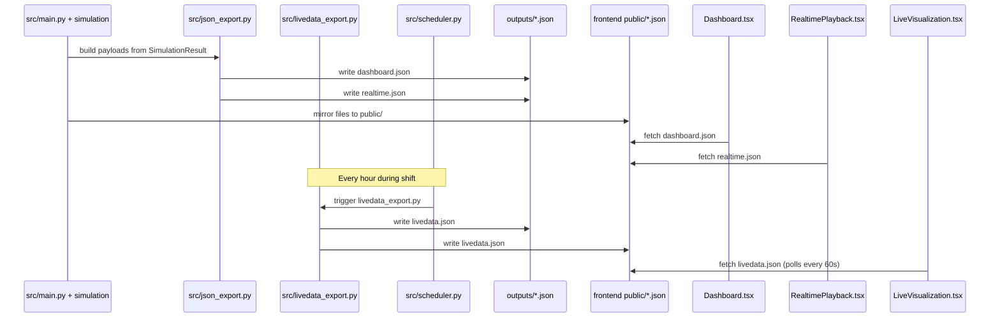

# JSON Contract Between Backend And Frontend

Last updated: 2026-05-04

Backend and frontend are integrated through generated JSON files only. There is no direct Python API call from React components.

## 1. Contract Files

| File | Producer | Consumer | Purpose |
|---|---|---|---|
| `outputs/dashboard.json` | `src/json_export.py::export_dashboard_json` | Dashboard view | End-of-run KPIs, machine metadata, timeline intervals, final stock, order summary |
| `outputs/realtime.json` | `src/json_export.py::export_realtime_json` | Realtime Playback view | Time-stepped plant snapshots |
| `outputs/livedata.json` | `src/livedata_export.py` | Live View (file-based mode) | Single-frame live snapshot, updated hourly |
| `outputs/history.json` | `src/history_export.py` + `src/snapshot_accumulator.py` | Dashboard — Plan vs Actual | Real production timeline from EDM Entrada/Saída events |
| `outputs/sim_ref_dt.json` | `src/main.py` | `src/api.py` background thread | Simulation reference datetime; used to anchor history rebuilds |
| `outputs/live_snapshots.json` | `src/snapshot_accumulator.py` | `src/api.py` background thread | Accumulated periodic machine-state snapshots |
| `Dashboard and Real-Time Playback/public/dashboard.json` | `src/main.py` | Frontend static server | Local dashboard data source |
| `Dashboard and Real-Time Playback/public/realtime.json` | `src/main.py` | Frontend static server | Local realtime data source |
| `Dashboard and Real-Time Playback/public/livedata.json` | `src/livedata_export.py` | Frontend static server | Local live view data source |
| `Dashboard and Real-Time Playback/public/history.json` | `src/history_export.py` + `src/main.py` | Frontend static server | Local history data source |

## 2. Generation Sequence



## 3. `dashboard.json`

## 3.1 Root shape

```json
{
  "kpis": {},
  "machines": [],
  "timeline": [],
  "stock_final": [],
  "orders": []
}
```

## 3.2 `kpis`

Produced in `export_dashboard_json(...)`.

| Field | Type | Semantics |
|---|---|---|
| `total_time_sec` | number | Simulated horizon in seconds |
| `total_trays` | number | Total tray target tracked in simulation |
| `total_parts` | number | Completed EDM pieces at end of run |
| `parts_per_hour` | number | `total_parts / (total_time_sec/3600)` |
| `global_oee` | number | Aggregated utilization proxy (`0..1`) |
| `changeover_loss_percentage` | number | `(sum(changeover_sec) / (total_time_sec * machines_count)) * 100` |
| `waiting_loss_percentage` | number | `(sum(waiting_sec) / (total_time_sec * machines_count)) * 100` |
| `orders_count` | number | Number of loaded orders |
| `machines_count` | number | Number of machine specs |
| `lines_count` | number | Number of distinct `line_id` values |
| `total_changeover_sec` | number | Total seconds of `changeover` events |
| `total_waiting_sec` | number | Total seconds of `waiting` events |
| `total_changeovers` | number | Count of `changeover` events |
| `changeovers_per_machine` | number | `total_changeovers / machines_count` |
| `total_test_sec` | number | Total seconds of `test` events |
| `total_process_sec` | number | Total seconds of `process` events |

## 3.3 `machines[]`

Each machine entry is static metadata plus final utilization.

```json
{
  "machine_id": "MACHINE_3206",
  "process_type": "LASER",
  "line_id": "LaserM",
  "machine_type": "3206",
  "static_oee": 0.6883
}
```

## 3.4 `timeline[]`

Event intervals from `SimulationResult.event_log`.

```json
{
  "machine_id": "EDM 1",
  "process_type": "EDM",
  "line_id": "Agie1",
  "tray_id": 96,
  "order_id": "6441840832",
  "part_number_id": "0433172203",
  "product_type": "0433172203",
  "pieces": 150,
  "activity": "process",
  "start_sec": 0,
  "end_sec": 5231.25
}
```

Supported activity values in current implementation:
- `process`
- `changeover`
- `waiting`
- `test`
- `inactive`

`inactive` is emitted as full-shift windows for machines without any work activity in that shift window.

## 3.5 `stock_final[]`

Final stock by EDM line, reconstructed from stock `put/get` events.

```json
{
  "line_id": "Agie1",
  "trays": 3,
  "parts": 450,
  "tray_details": [
    {
      "tray_id": 12,
      "order_id": "ORD-001",
      "part_number_id": "PN-100",
      "product_type": "CRIN"
    }
  ]
}
```

## 3.6 `orders[]`

Order-level production summary from simulation result.

```json
{
  "order_id": "6441840832",
  "part_number_id": "0433172203",
  "product_type": "0433172203",
  "quantity": 450,
  "trays": 3,
  "produced_pieces": 450
}
```

`produced_pieces` can be greater than original quantity because tray generation rounds by tray-size rules.

## 4. `realtime.json`

## 4.1 Root shape

```json
{
  "metadata": {
    "step_sec": 60.0,
    "total_time_sec": 86400.0,
    "generated_at": "2026-02-19T10:00:00+00:00"
  },
  "frames": []
}
```

## 4.2 `metadata`

| Field | Type | Semantics |
|---|---|---|
| `step_sec` | number | Sampling interval used to create frames |
| `total_time_sec` | number | Same horizon as dashboard payload |
| `generated_at` | string | UTC ISO timestamp of export generation |

## 4.3 `frames[]`

One frame per sampled `time_sec` value.

```json
{
  "time_sec": 3600.0,
  "backlog_orders": ["1372875248"],
  "produced_orders": [],
  "stock_levels": [],
  "machines": []
}
```

### 4.3.1 `backlog_orders`
List of `order_id` values where first `process` event has not started yet (`start_sec > frame.time_sec` or missing).

### 4.3.2 `produced_orders`
Orders that already have EDM completion at this frame.

```json
{
  "order_id": "6441840832",
  "part_number_id": "0433172203",
  "product_type": "0433172203",
  "quantity": 450,
  "trays": 3,
  "produced_pieces": 150,
  "completed_trays": 1,
  "completion_pct": 0.3333
}
```

Field semantics:
- `completed_trays`: number of EDM tray completions with `end_sec <= frame.time_sec`
- `completion_pct`: `min(1.0, completed_trays / trays)`
- `produced_pieces`: `completed_trays * (summary.produced_pieces / summary.trays)`

### 4.3.3 `stock_levels`
Frame-specific stock snapshot built by replaying stock events up to `frame.time_sec`.
Shape is equivalent to `stock_final[]`.

### 4.3.4 `machines[]`
Machine state at frame time.

```json
{
  "machine_id": "MACHINE_3206",
  "process_type": "LASER",
  "line_id": "LaserM",
  "machine_type": "3206",
  "static_oee": 0.6883,
  "state": {
    "activity": "process",
    "order_id": "8162224000",
    "part_number_id": "0433175518",
    "product_type": "0433175518",
    "tray_id": 61,
    "start_sec": 0,
    "end_sec": 688.5,
    "current_oee": 0.0
  }
}
```

`state` resolution rule:
- pick event where `start_sec <= time_sec < end_sec`
- if multiple match, keep latest start
- if no match, state is:

```json
{
  "activity": "idle",
  "current_oee": 0.0
}
```

`current_oee` is cumulative utilization up to frame time using busy activities (`process`, `changeover`, `test`).

## 5. `livedata.json`

Unlike `realtime.json` (multi-frame simulation playback), `livedata.json` is a
**single-frame snapshot** of the current production floor, served live by `src/api.py`
(or refreshed hourly by `src/scheduler.py` → `src/livedata_export.py` in file-based mode).

## 5.1 Root shape

```json
{
  "metadata": {
    "generated_at": "2026-04-17T15:00:00+00:00",
    "current_time_label": "15:00"
  },
  "orders_by_id": {},
  "hard_stage_market": [],
  "snapshot": {}
}
```

## 5.2 `metadata`

| Field | Type | Semantics |
|---|---|---|
| `generated_at` | string | UTC ISO timestamp of when this snapshot was taken |
| `data_last_updated` | string\|null | ISO timestamp of the most recent `DT_UPDATE` in `b2b_machine_status` (DB staleness indicator) |
| `current_time_label` | string | Human-readable time label, e.g. `"15:00"` (facility local time) |
| `facility_timezone` | string | IANA timezone of the facility, e.g. `"America/Sao_Paulo"` |

## 5.3 `orders_by_id`

Keyed by `order_id`. Source: `fetch_orders()` → `silver_orders.orders_10digit`.
All rows in the table are open orders — no additional status filter is applied.

```json
{
  "0642438376": {
    "order_id": "0642438376",
    "part_number_id": "0433171457",
    "quantity": 96,
    "due_date": "2026-03-31"
  }
}
```

## 5.4 `hard_stage_market[]`

Hard Stage Market inventory grouped by body part number.
Source: `fetch_hard_stage_market()` → `silver_production.inventory`.
Sorted client-side by **highest `body_qtty`** first.

```json
{
  "body_partnumber": "24386S0464",
  "body_qtty": 5338,
  "nozzles": ["0433171855", "0433171860", "0433171945"]
}
```

| Field | Type | Semantics |
|---|---|---|
| `body_partnumber` | string | Body BODY_TYPE_NUMBER |
| `body_qtty` | number | Current Hard Stage stock quantity (pieces) |
| `nozzles` | string[] | All nozzle TYPE_NUMBERs associated with this body |

## 5.5 `snapshot`

A live snapshot of the current factory state. Shape extends `RealtimeFrame` with additional live-only fields.

### Core fields (same shape as `realtime.json` frames)

| Field | Source |
|---|---|
| `time_sec` | Always 0 in live mode (no shift offset) |
| `backlog_orders[]` | All `ORDER_NUMBER` from `silver_orders.orders_10digit` |
| `produced_orders[]` | `fetch_produced_today()` — all AGIE Saída since 2026-04-01, grouped by TypeNumber |
| `machines[]` | `fetch_machine_status()` + `fetch_machine_oee()` — 50 AGIE machines |
| `stock_levels[]` | `fetch_buffer_stock()` — trays in buffer (Gravadora Saída, not yet at AGIE) |

### Live-only extension fields

| Field | Type | Source | Semantics |
|---|---|---|---|
| `laser_summary[]` | `LaserSummaryItem[]` | `fetch_laser_status()` | TypeNumbers currently at the laser, with tray and piece counts |
| `finished_goods[]` | `StockInfo[]` | `fetch_finished_goods()` | Legacy: trays in AGIE output supermarket, by corridor *(will be deprecated)* |
| `he_market[]` | `FinalMarketItem[]` | `_build_final_markets()` | TypeNumbers destined for HE, with order progress |
| `packaging_market[]` | `FinalMarketItem[]` | `_build_final_markets()` | TypeNumbers destined for Packaging, with order progress |

### `LaserSummaryItem`

```json
{
  "part_number_id": "0433172203",
  "waiting_trays": 3,
  "waiting_pieces": 450,
  "done_trays": 0,
  "done_pieces": 0
}
```

### `FinalMarketItem`

```json
{
  "part_number_id": "0433172203",
  "total_pieces": 355,
  "oldest_entry_date": "2026-04-17T08:32:00",
  "pending_orders": [
    {
      "order_id": "0642438376",
      "quantity": 2000,
      "due_date": "2026-04-20",
      "remaining_needed": 1645
    }
  ]
}
```

| Field | Type | Semantics |
|---|---|---|
| `total_pieces` | number | Remaining pieces after fulfilled orders have been subtracted |
| `oldest_entry_date` | string\|null | ISO datetime of the first tray's arrival in this market |
| `pending_orders[]` | array | Open orders sorted oldest `due_date` first |
| `pending_orders[].remaining_needed` | number | `max(0, order.quantity - pieces_accumulated_so_far)` |

### Date filter applied to all location queries

All queries that determine where a serial number currently is apply `DATE >= '2026-04-01'`:
- `fetch_laser_status` — CTE `last_event`
- `fetch_buffer_stock` — CTE `last_event`
- `fetch_finished_goods` — CTE `last_machine_event`
- `fetch_machine_status` — CTE `already_out`
- `fetch_produced_today` — direct WHERE

`fetch_machine_oee` uses its own `oee_hours` window (not the 2026-04-01 cutoff).

## 6. `history.json`

Real production timeline used for Plan vs Actual comparison in the Dashboard.

Produced by `src/history_export.py` (initial run) and continuously rebuilt by `src/snapshot_accumulator.py`
(every 30 min via the API background thread). Also served by `GET /api/history`.

## 6.1 Root shape

```json
{
  "metadata": {
    "generated_at": "2026-05-04T14:00:00+00:00",
    "description": "Real production history (EDM Entrada/Saída pairs)",
    "snapshot_time_sec": 28800.0,
    "snapshot_time_label": "14:00",
    "facility_timezone": "America/Sao_Paulo"
  },
  "timeline": []
}
```

## 6.2 `metadata`

| Field | Type | Semantics |
|---|---|---|
| `generated_at` | string | UTC ISO timestamp of generation |
| `description` | string\|null | Human-readable description |
| `snapshot_time_sec` | number | Seconds from shift start at time of snapshot |
| `snapshot_time_label` | string\|null | Human-readable label, e.g. `"14:00"` |
| `facility_timezone` | string\|null | IANA timezone, e.g. `"America/Sao_Paulo"` |

## 6.3 `timeline[]`

Same event shape as `dashboard.json` timeline entries.

```json
{
  "machine_id": "AGIE 01",
  "process_type": "EDM",
  "line_id": "Agie1",
  "order_id": "6441840832",
  "part_number_id": "0433172203",
  "activity": "process",
  "start_sec": 0,
  "end_sec": 5231.25
}
```

Supported `activity` values: `process`, `changeover`.

Events are offset in seconds from `sim_ref_dt` (the simulation reference datetime written to `sim_ref_dt.json`).
In-progress trays (Entrada without Saída) produce events whose `end_sec` equals the current wall-clock offset.

## 7. Cross-File Invariants

These invariants are expected by the frontend and backend exporters.

- All time fields are seconds (`float` or `int`).
- All IDs are strings.
- OEE/utilization fields are `0..1` ratios.
- Activity values are aligned with frontend color maps and status labels.
- `machines[].static_oee` is stable across realtime frames.
- `timeline` events are independent intervals; frontend groups and sorts by machine.

## 8. Type Mirror In Frontend

TypeScript contract mirror is defined in:
- `Dashboard and Real-Time Playback/src/app/data.ts`

Primary interfaces:
- `DashboardData`
- `RealtimeData`
- `LiveData`
- `LiveMetadata`
- `HistoryData`
- `HardStageMarketItem`
- `FinalMarketItem`
- `FinalMarketOrder`
- `LaserSummaryItem`
- `KPI`
- `TimelineEvent`
- `MachineState`
- `OrderMeta`
- `StockInfo`

Backend contract changes must be reflected here.

## 9. Contract Evolution Workflow

When changing payload shape:

1. Update exporter code in `src/json_export.py` or `src/api.py` / `src/data_gathering.py`.
2. Regenerate JSON (`python launch.py --no-frontend` for simulation; restart `uvicorn src.api:app` for live view).
3. Update TS interfaces in `src/app/data.ts`.
4. Update component usage in:
   - `Dashboard.tsx`
   - `RealtimePlayback.tsx`
   - `LiveVisualization.tsx`
5. Re-run frontend and verify all views with generated JSON.

## 10. Additive Compatibility Rules

For stable evolution:
- Prefer additive fields over renaming/removing existing keys.
- Keep existing keys and units unchanged unless both backend and frontend are updated in the same change.
- Keep numeric fields as numbers, not strings.
- Keep existing activity names if current UI depends on them.